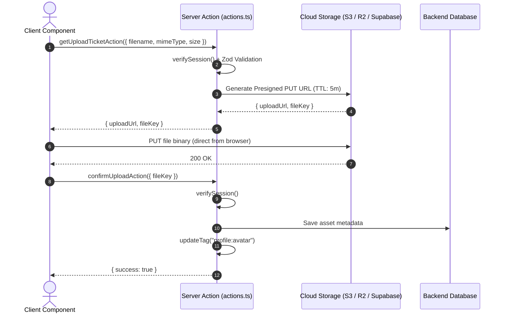

# Advanced Data Fetching, Caching & Production Patterns

Production extensions for `apps/web` running on **Next.js 16.4.2** with `cacheComponents: true` and `partialPrefetching: true`.
Complements [data-fetching.md](data-fetching.md) and [authentication.md](authentication.md).
Sources resolve from `apps/web/node_modules/next/dist/docs/01-app/` (`DOCS/`).

---

## 1. Instant Navigation & Regression Testing (`@next/playwright`)

### 1.1 Mental Model
With Cache Components and Partial Prefetching, a client navigation should display the **App Shell + Fallback UI immediately (0 ms delay)**, while dynamic segments stream in.
A developer inadvertently calling `await cookies()`, `await searchParams`, or uncached I/O at the top level of a shared layout or page will cause a "blocking route" regression, delaying the navigation transition until the server finishes computing.

Next.js provides the `@next/playwright` package with the `instant()` assertion to lock in this behavior during E2E tests (`DOCS/02-guides/instant-navigation.md`).

### 1.2 Setup
`@next/playwright` (exact `16.4.2`, same as `next`) and `@playwright/test` are devDependencies of `apps/web`. Specs live in `apps/web/e2e/`.

The testing API exists automatically in `next dev`, but prefetching does not run there, so prefetch behavior is only testable on a **production build**. A production build contains the testing API only when it is built with the flag below; never ship such a build.

```ts
// apps/web/next.config.ts
experimental: {
  exposeTestingApiInProductionBuild: process.env.EXPOSE_TESTING_API === "1",
}
```

```bash
EXPOSE_TESTING_API=1 pnpm build   # the variable must be set at build time
pnpm --filter web start           # then run the specs against next start
```

Setting `EXPOSE_TESTING_API` only for `next start` does not add the testing API to an existing build. A plain `pnpm build` (CI `build` job, deploys) has no testing API.

### 1.3 Test Implementation Pattern
Signature: `instant(page, fn, { baseURL })`. `page` comes first; pass `baseURL` when `page.goto()` is the first navigation inside the callback. Inside `fn`, only the immediately available UI (static shell, or the destination's prefetched UI) renders; other dynamic content stays blocked until `fn` returns.

For a client navigation, **wait for the destination URL before asserting**, otherwise a shared selector can match the source page. Then also assert that content which must wait is absent, and present after the scope ends.

```ts
// apps/web/e2e/feature-instant.spec.ts
import { expect, test } from "@playwright/test"
import { instant } from "@next/playwright"

test("client navigation to /dashboard/settings is instant", async ({ page }) => {
  await page.goto("/dashboard")

  await instant(page, async () => {
    await page.click('a[href="/dashboard/settings"]')
    await page.waitForURL((url) => url.pathname === "/dashboard/settings")
    await expect(page.locator("h1")).toContainText("Settings")
  })

  // Streamed content settles after the instant() scope ends.
  await expect(page.getByTestId("settings-card")).toBeVisible()
})

test("initial load shows the static shell", async ({ page, baseURL }) => {
  await instant(
    page,
    async () => {
      await page.goto("/dashboard/settings")
      await expect(page.locator("h1")).toContainText("Settings")
    },
    { baseURL }
  )
})
```

`instant()` fails if the navigation stalls on a server render without committing the prefetched UI, so regressions are blocked in CI. Source: `DOCS/02-guides/instant-navigation.md` ("Prevent regressions with e2e tests").

---

## 2. Distributed Remote Cache (`cacheHandlers` + Redis / Upstash)

### 2.1 Why and When
The default cache store in Next.js 16 is an in-memory LRU cache limited to 50 MB (`cacheMaxMemorySize`).
In serverless environments (Vercel, AWS Lambda) or multi-container clusters (Docker/Kubernetes):
- Memory is ephemeral and isolated per container/instance.
- In-memory entries do not survive serverless container restarts or scale-out events.

`"use cache: remote"` combined with `cacheHandlers` in `next.config.ts` delegates storage to a shared external store (e.g. Redis, Keyv, DynamoDB) (`DOCS/03-api-reference/05-config/01-next-config-js/cacheHandlers.md`).

### 2.2 Implementing `CacheHandler`
A custom cache handler must implement the 5 required methods from `next/cache`:
`get`, `set`, `refreshTags`, `getExpiration`, `updateTags`.

> [!IMPORTANT]
> - `entry.value` arrives as a `ReadableStream<Uint8Array>`. It can only be consumed once. Do NOT store the stream directly; buffer the bytes into your storage.
> - On every `get()` hit, wrap the stored bytes in a **fresh** `new ReadableStream()`.
> - Never store tokens, passwords, or PII in `cacheKey` or tags.

```ts
// apps/web/cache-handlers/redis-handler.js
const { createClient } = require('redis')

const client = createClient({ url: process.env.REDIS_URL })
client.connect().catch((err) => console.error('Redis Cache Handler error:', err))

const localTagTimestamps = new Map()

module.exports = {
  async get(cacheKey, softTags) {
    try {
      const raw = await client.get(`cache:${cacheKey}`)
      if (!raw) return undefined

      const data = JSON.parse(raw)

      // Reconstruct single-use ReadableStream over stored base64 bytes
      return {
        value: new ReadableStream({
          start(controller) {
            controller.enqueue(Buffer.from(data.value, 'base64'))
            controller.close()
          },
        }),
        tags: data.tags,
        stale: data.stale,
        timestamp: data.timestamp,
        expire: data.expire,
        revalidate: data.revalidate,
      }
    } catch {
      // Safe fallback on cache failure: return undefined to trigger dynamic render
      return undefined
    }
  },

  async set(cacheKey, pendingEntry) {
    const entry = await pendingEntry
    const reader = entry.value.getReader()
    const chunks = []

    try {
      while (true) {
        const { done, value } = await reader.read()
        if (done) break
        chunks.push(value)
      }
    } finally {
      reader.releaseLock()
    }

    const buffer = Buffer.concat(chunks.map((c) => Buffer.from(c)))

    await client.set(
      `cache:${cacheKey}`,
      JSON.stringify({
        value: buffer.toString('base64'),
        tags: entry.tags,
        stale: entry.stale,
        timestamp: entry.timestamp,
        expire: entry.expire,
        revalidate: entry.revalidate,
      }),
      { EX: entry.expire } // Redis TTL
    )
  },

  async refreshTags() {
    // Sync invalidated tags from Redis before serving cache entries
    const tagKeys = await client.sMembers('revalidated-tags')
    if (tagKeys.length > 0) {
      const values = await client.mGet(tagKeys.map((k) => `tag:${k}`))
      for (let i = 0; i < tagKeys.length; i++) {
        localTagTimestamps.set(tagKeys[i], Number(values[i]))
      }
    }
  },

  async getExpiration(tags) {
    const timestamps = tags.map((t) => localTagTimestamps.get(t) || 0)
    return Math.max(...timestamps, 0)
  },

  async updateTags(tags, durations) {
    const now = Date.now()
    const pipeline = client.multi()
    for (const tag of tags) {
      pipeline.set(`tag:${tag}`, String(now))
      pipeline.sAdd('revalidated-tags', tag)
      localTagTimestamps.set(tag, now)
    }
    await pipeline.exec()
  },
}
```

### 2.3 Configuration in `next.config.ts`
```ts
// apps/web/next.config.ts
import type { NextConfig } from 'next'

const nextConfig: NextConfig = {
  cacheComponents: true,
  partialPrefetching: true,
  cacheHandlers: process.env.REDIS_URL
    ? {
        remote: require.resolve('./cache-handlers/redis-handler.js'),
      }
    : undefined,
}

export default nextConfig
```

### 2.4 Code Directive Usage
```ts
// features/reports/queries.ts
import { cacheLife, cacheTag } from 'next/cache'

export async function getAggregatedReport(dateRange: string) {
  'use cache: remote'
  cacheTag('reports:aggregated')
  cacheLife('hours')
  return fetchExpensiveReportFromBackend(dateRange)
}
```

---

## 3. Large File & Media Uploads (Presigned URL Architecture)

### 3.1 Constraints
- Next.js Server Actions have a default body limit (`serverActions.bodySizeLimit: '1mb'`).
- Streaming large payloads (10 MB – 1 GB+) through Node.js or serverless instances exhausts memory, blocks the event loop, and causes timeout failures.

### 3.2 The Presigned Direct Upload Pattern
To preserve high performance and keep the DAL boundaries clean:
1. **Request Upload Ticket**: Client Component calls a Server Action to request a presigned URL.
2. **Authorize & Sign**: Server Action validates session (`verifySession`), checks authorization, enforces MIME type / max file size via Zod, and requests a Presigned PUT URL from storage (S3 / Cloudflare R2 / Supabase Storage).
3. **Direct Upload from Browser**: Client sends the raw file binary directly to cloud storage via `fetch` with `PUT`.
4. **Confirm & Invalidate**: Client calls a second Server Action to confirm the upload, record the asset in the database, and call `updateTag()` to refresh UI caches.



---

## 4. Real-time Streaming & Live Data (SSE & Channels)

### 4.1 Server-Sent Events (SSE) Route Handler
When a feature requires live updates without installing heavy client libraries, Server-Sent Events (SSE) can be implemented in a Route Handler.

> [!NOTE]
> **Why `connection()` here instead of `io()`?**
> In normal Server Components and queries, the repo rule is **prefer `io()` from `next/cache`** because `io()` allows prefetching and works inside `"use cache: private"`. Values that per-user reads depend on (the DAL's `getSession`, `getToday` in `lib/clock.ts`) go one step further and are `"use cache: private"` themselves, so the reads after them stay in the App Shell (data-fetching §1, §4.3).
> However, an SSE Route Handler is one of the rare legitimate use cases for `connection()` from `next/server`: you **must wait for a real user request** and **deliberately block prefetching** (`DOCS/03-api-reference/04-functions/io.md`). You never want a `<Link>` hover or prefetch to trigger an open, persistent event stream and leak server connections.

```ts
// apps/web/app/api/live-events/route.ts
import { connection } from 'next/server'
import { verifySession } from '@/lib/dal'

export async function GET(request: Request) {
  // 1. Wait for real user request & block any prefetch
  await connection()

  // 2. Authorize
  const session = await verifySession()
  if (!session) {
    return new Response('Unauthorized', { status: 401 })
  }

  // 3. Create readable stream
  const encoder = new TextEncoder()
  const stream = new ReadableStream({
    start(controller) {
      const interval = setInterval(() => {
        const payload = `data: ${JSON.stringify({ timestamp: Date.now() })}\n\n`
        controller.enqueue(encoder.encode(payload))
      }, 3000)

      request.signal.addEventListener('abort', () => {
        clearInterval(interval)
        controller.close()
      })
    },
  })

  return new Response(stream, {
    headers: {
      'Content-Type': 'text/event-stream',
      'Cache-Control': 'no-cache, no-transform',
      Connection: 'keep-alive',
    },
  })
}
```

### 4.2 Revalidating Server Components from Real-time Events
When a real-time event arrives on the client (via SSE or Supabase Realtime Channels), instead of keeping parallel state in React state:
1. Call `router.refresh()`.
2. Next.js re-executes the route's Server Components in the background.
3. React reconciles and updates the DOM in-place without losing client state (form inputs, focus, scroll position).

---

## 5. Observability, Background Tasks & Error Telemetry

### 5.1 Non-blocking Work with `after()`
`after()` (from `next/server`) schedules asynchronous work to run **after** the response stream has completed (`DOCS/03-api-reference/04-functions/after.md`).
Use it for audit logs, analytics, and notification dispatch without delaying the user's paint:

```ts
// features/<domain>/actions.ts
'use server'
import { after } from 'next/server'
import { verifySession } from '@/lib/dal'
import { updateTag } from 'next/cache'

export async function updateItemAction(itemId: string, note: string) {
  const session = await verifySession()

  // 1. Critical path: write to DB
  await patchItem(session.accessToken, itemId, { note })
  updateTag(`items:${session.userId}`)

  // 2. Non-blocking: background telemetry & audit log
  after(async () => {
    await sendAuditLog({
      userId: session.userId,
      action: 'item.update',
      itemId,
      timestamp: Date.now(),
    })
  })

  return { success: true }
}
```

### 5.2 Centralized Server Error Tracking with `instrumentation.ts`
Next.js 16 provides the `onRequestError` export in `instrumentation.ts` to capture unhandled errors across Server Components, Route Handlers, Server Actions, and Proxy (`DOCS/03-api-reference/03-file-conventions/instrumentation.md`):

```ts
// apps/web/instrumentation.ts
import type { Instrumentation } from 'next'

export function register() {
  // Initialize OpenTelemetry SDK if configured
}

export const onRequestError: Instrumentation.onRequestError = async (
  err,
  request,
  context
) => {
  const errorMessage = err instanceof Error ? err.message : String(err)
  const digest =
    typeof err === 'object' && err !== null && 'digest' in err
      ? String((err as { digest?: unknown }).digest)
      : undefined

  // Filter out normal control-flow throws (redirect() and notFound() throw internal symbols)
  if (errorMessage.includes('NEXT_REDIRECT') || errorMessage.includes('NEXT_NOT_FOUND')) {
    return
  }

  const payload = {
    message: errorMessage,
    digest,
    path: request.path,
    method: request.method,
    routeType: context.routeType,     // 'render' | 'route' | 'action' | 'proxy'
    routerKind: context.routerKind,   // 'App Router' | 'Pages Router'
    timestamp: new Date().toISOString(),
  }

  // Forward to centralized monitoring (e.g. Sentry, Datadog, or external log collector)
  console.error('[SERVER_ERROR]', JSON.stringify(payload))
}
```

---

## 6. Production Architecture Checklist

- [ ] **E2E Regressions**: High-value flows (e.g. Dashboard, Case Lists) have `@next/playwright` `instant()` test coverage.
- [ ] **Distributed Cache**: If deploying on multi-instance serverless/containers, `cacheHandlers.remote` is connected to Redis/Upstash.
- [ ] **File Uploads**: Files larger than 1 MB bypass Server Actions and use presigned direct-to-storage URLs.
- [ ] **Live Data**: SSE handlers call `await connection()` and coordinate with `router.refresh()`.
- [ ] **Telemetry**: Server Actions offload audit logs to `after()`; server crashes are captured in `instrumentation.ts` via `onRequestError`.
