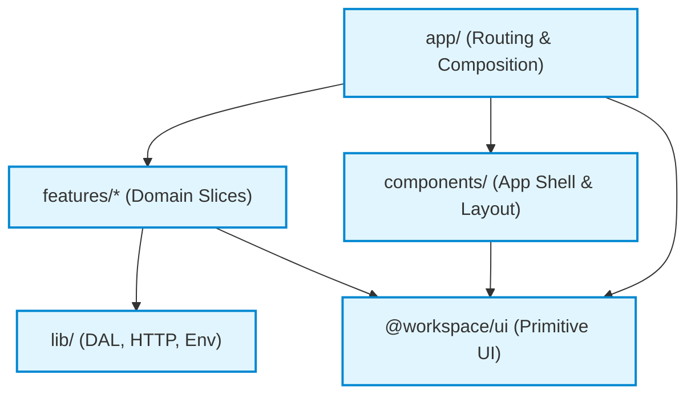
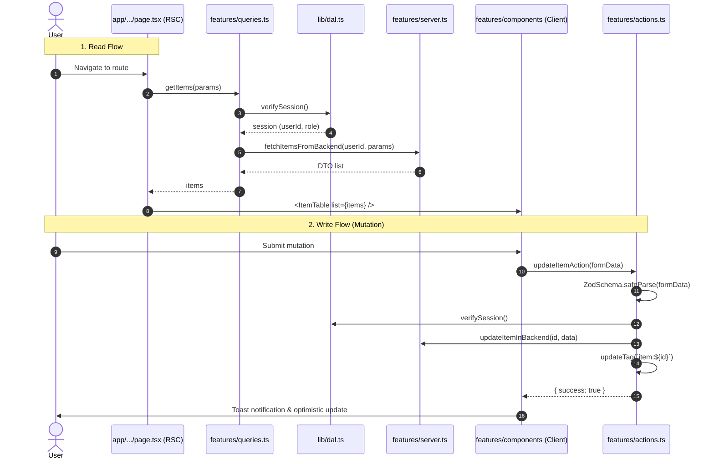

# Project Structure and Monorepo Architecture

Comprehensive architectural guide for **next-mono-base** running on **Next.js 16.4.0** and **Turborepo**.
This document defines how code is organized across the monorepo, the feature-based layout inside `apps/web`, boundary rules enforced by ESLint, and strict criteria for extracting shared packages.

---

## 1. Core Architectural Principles

1. **Vertical Slices (Feature-Based)**: Code is organized by business domain (`features/<name>/`), not by technical type (no top-level `controllers/`, `services/`, or `views/`). A feature owns its UI, queries, mutations, validation, and types.
2. **`app/` is Routing & Composition Only**: Pages and layouts contain zero business logic and zero direct database/backend calls. They authenticate, invoke feature queries, assemble feature components, and pass down data via props.
3. **Route-Agnostic Features**: Features know nothing about URLs, route params, or Next.js route structures. This allows feature components to be reused across pages, dialogs, or embedded panes without changes.
4. **RSC-First & Explicit Server/Client Boundaries**: Data reading happens in async Server Components; data writing happens in Server Actions. Any file touching external data sources or secrets is marked `import "server-only"`.
5. **Enforced by ESLint, Not Good Intentions**: Architectural boundaries (e.g. features cannot import other features or `app/`, client components cannot import server code) are hard-enforced in `apps/web/eslint.config.js` and fail CI via `eslint --max-warnings 0`.

---

## 2. Directory Layout

```
next-mono-base/
├── apps/
│   └── web/                                # The primary Next.js 16.4 application
│       ├── app/                            # Routing & composition only (page.tsx, layout.tsx)
│       │   ├── (auth)/                     # Route group: sign-in, sign-up
│       │   ├── (dashboard)/                # Route group: authenticated application shell
│       │   │   └── dashboard/
│       │   │       └── page.tsx            # Protected dashboard home
│       │   ├── api/                        # Route Handlers (webhooks, external integrations)
│       │   ├── error.tsx                   # Route error boundary
│       │   ├── global-error.tsx            # Root layout fatal error boundary
│       │   ├── not-found.tsx               # 404 handler
│       │   ├── robots.ts                   # Programmatic SEO robots.txt
│       │   ├── sitemap.ts                  # Programmatic XML sitemap
│       │   └── layout.tsx                  # Root HTML shell
│       ├── features/                       # Vertical business domain slices
│       │   ├── auth/                       # Authentication reference feature (forms, actions, schemas)
│       │   └── <domain>/                   # Custom business domains (e.g. billing, workspace, etc.)
│       ├── components/                     # App-wide UI (shell, navigation, providers)
│       │   ├── layout/                     # App sidebar, header, global nav
│       │   └── providers/                  # ThemeProvider, Toaster, etc.
│       ├── lib/                            # Application-level infrastructure (Server-only / DAL)
│       │   ├── auth/                       # Provider implementations (Better Auth, Supabase)
│       │   ├── dal.ts                      # Data Access Layer (verifySession, getSession)
│       │   ├── env.ts                      # Validated environment variables (Zod)
│       │   ├── http.ts                     # Backend HTTP client (apiFetch)
│       │   ├── errors.ts                   # Domain & API error classes
│       │   └── utils.ts                    # General helpers
│       ├── config/                         # Static site metadata, navigation items, constants
│       ├── hooks/                          # App-wide reusable React hooks (client-only)
│       ├── proxy.ts                        # Optimistic session check & token refresh (runs in middleware)
│       ├── next.config.ts                  # Cache Components & Partial Prefetching flags
│       └── eslint.config.js                # Boundary enforcement rules
├── packages/
│   ├── ui/                                 # Primitive shadcn/ui components (@workspace/ui)
│   ├── eslint-config/                      # Shared ESLint flat configurations
│   └── typescript-config/                  # Shared tsconfig base files
├── docs/                                   # Single Source of Truth architecture documentation
├── turbo.json                              # Turborepo task pipeline
└── package.json                            # Monorepo root (pnpm workspace)
```

### Why No `src/` Directory in `apps/web`?
- **Matches shadcn/ui Standard**: Scaffolding with `components.json` directly targets `@/components`, `@/lib`, and `@/hooks`.
- **Flatter Navigation**: Avoids redundant nesting (`apps/web/src/app/...` vs `apps/web/app/...`).
- **Path Mapping**: `@/*` in `tsconfig.json` maps cleanly to `./*`.

---

## 3. Anatomy of a Feature (`features/<name>/`)

Every feature folder represents an isolated business domain slice:

```
features/<name>/
├── components/         # UI components (Client or Server) specific to this domain
│   ├── <name>-table.tsx
│   └── <name>-filters.tsx
├── server.ts           # [server-only] The only backend I/O; DTOs via Zod. Two stacks: picks server.api.ts / server.supabase.ts (docs/providers.md)
├── queries.ts          # Reads for Server Components; verifies session via DAL; "use cache"
├── actions.ts          # [use server] Mutations; validates input; checks auth; calls updateTag()
├── schemas.ts          # Zod schemas & TypeScript types; safe for both client and server
└── __tests__/          # Colocated unit and integration tests
```

> [!IMPORTANT]
> **Create only the files a feature actually needs.**
> A simple feature may only contain `components/` and `schemas.ts`. Do not scaffold empty `server.ts` or `actions.ts` files if the feature does not perform backend I/O or mutations.

### File Responsibilities

| File | Directive | Allowed Imports | Forbidden Imports | Primary Responsibility |
| :--- | :--- | :--- | :--- | :--- |
| `server.ts` | `import "server-only"` | `lib/http`, `lib/env`, DB clients, Zod | `lib/dal`, `next/headers`, `cookies()`, `app/` | Pure I/O. Does not know about user sessions or request caches. Returns typed DTOs. |
| `queries.ts` | None / `"use cache"` | `lib/dal`, `./server`, `./schemas` | `app/`, other features | Data reader for Server Components. Calls `verifySession()`, invokes `server.ts`, manages cache lifetimes. |
| `actions.ts` | `"use server"` | `lib/dal`, `./server`, `./schemas`, `next/cache` | `app/`, other features | Form/action mutations. Calls `verifySession()`, validates with Zod, writes via `server.ts`, calls `updateTag()`. |
| `schemas.ts` | None | `zod` | Any server-only module | Single Source of Truth for domain models, form input schemas, and inferred TypeScript types. |
| `components/` | None or `"use client"`| `@workspace/ui`, `./schemas`, `actions.ts` | `server.ts`, `queries.ts`, `lib/dal`, `lib/http` | Presentational and interactive UI. Receives query data via props or un-awaited promises. |

---

### 3.1 Component Scopes & Placement Strategy

When creating a new component, choose its location based on **reusability scope** and **domain ownership**:

| Scope | Location | When to Use | Example |
| :--- | :--- | :--- | :--- |
| **Page-Local** | `app/**/_components/` | Used on **only one page** or route. Next.js ignores `_` folders from routing. | `app/(dashboard)/<name>/_components/<name>-hero.tsx` |
| **Feature-Domain** | `features/<name>/components/` | Used across **multiple pages within the same feature/domain**. | `features/auth/components/sign-in-form.tsx` |
| **App-Wide Shell** | `components/layout/` | App shell, navigation, global header, sidebar. | `components/layout/sidebar.tsx` |
| **App-Wide Shared** | `components/shared/` | Reusable across **multiple features**, but specific to `apps/web` (pure presentational UI). | `components/shared/empty-state.tsx`, `components/shared/confirm-dialog.tsx` |
| **Primitive UI** | `packages/ui/src/components/` | Generic, **zero-business-logic** primitives from shadcn/ui. | `@workspace/ui/components/button` |

#### How to Share UI Across Features Without Violating ESLint (`features/A` cannot import `features/B`)

When Feature A needs to render a component owned by Feature B (for example, a `DataTable` in Feature A needs to display an `AuthorBadge` from Feature B):

1. **Composition via Slots / Children in `app/**/page.tsx` (Recommended)**:
   Keep features completely decoupled. Let the page compose them together:
   ```tsx
   // apps/web/app/(dashboard)/projects/page.tsx
   import { ProjectTable } from "@/features/projects/components/project-table"
   import { UserAvatar } from "@/features/users/components/user-avatar"

   export default async function Page() {
     const projects = await getProjects()
     return (
       <ProjectTable
         list={projects}
         renderUser={(user) => <UserAvatar name={user.name} image={user.avatarUrl} />}
       />
     )
   }
   ```
2. **Promote to `apps/web/components/shared/` (If Ubiquitous)**:
   If a component is a pure presentational UI element used everywhere (e.g. `UserAvatar` or `StatusBadge`), place it in `apps/web/components/shared/`.
   *Requirement*: It must only accept pure props and must **never** import `server.ts`, `queries.ts`, `@/lib/dal`, or `@/lib/http`.

---

### 3.2 Component Composition & Scaling Rules (Vercel Guidelines)

When designing components across features and shared libraries, follow Vercel's official composition rules:

#### 1. Avoid Boolean Prop Proliferation
Never add multiple boolean props (`isCompact`, `isAdmin`, `hasHeader`, `isEditing`, `showUser`) to customize a single monolithic component. Each boolean doubles component states and creates unmaintainable branching.
- **Fix**: Use **Compound Components** (e.g., `<CasesTable.Frame>`, `<CasesTable.Header>`, `<CasesTable.Row>`) or create **Explicit Variants** (`<AdminCasesTable>` vs `<UserCasesTable>`).

#### 2. Prefer Composing Children Over Render Props
- Use `children` for structural layout composition (`<Card><CardHeader /><CardBody /></Card>`).
- Only use render props when the parent component must supply item-level data back to the child (e.g., `<List data={items} renderItem={({ item }) => <ItemRow item={item} />} />`).

#### 3. Decouple State Management from UI
Structure component context around a generic contract:
```ts
interface ComponentContextValue<TState, TActions> {
  state: TState
  actions: TActions
  meta?: Record<string, unknown>
}
```
UI components consume this interface via `use(Context)`. This allows swapping the provider implementation (e.g. Server-backed vs local client state) without changing a single line of UI.

#### 4. React 19 Native Standards
- **No `forwardRef`**: `ref` is a standard component prop in React 19 (`{ ref, ...props }: Props & { ref?: React.Ref<T> }`).
- **`use()` instead of `useContext()`**: Use `use(Context)` for reading React contexts conditionally or at top level.
- **Pass Promises directly**: Pass un-awaited promises from Server Components to Client Components and resolve via `use(promise)`.

---

## 4. Dependency Direction & ESLint Boundary Enforcement

### Layer Hierarchy



### Boundary Rules Enforced in `apps/web/eslint.config.js`

1. **Features Never Import `app/`**:
   - `features/**` must never import from `@/app/**`.
   - *Reason*: Features are route-agnostic and reusable.
2. **No Cross-Feature Imports**:
   - `features/A` must never import from `features/B` or `@/features/**`.
   - *Reason*: Prevents circular dependencies and spaghetti coupling between domains. If two features need to interact on screen, compose them together in `app/**/page.tsx`.
3. **Feature Components Never Import Server-Only Modules**:
   - `features/*/components/**` cannot import `server.ts`, `queries.ts`, `@/lib/dal`, `@/lib/http`, or `@/lib/auth`.
   - *Reason*: Protects client component bundles from leaking server secrets or failing compilation.
4. **Shared Components Never Import Server-Only Modules**:
   - `components/**` cannot import `@/lib/dal`, `@/lib/http`, or `@/lib/auth`.
   - *Reason*: Shell components (`layout/`, `providers/`) are frequently Client Components or render across auth boundaries.
5. **No Barrel Files (`index.ts`)**:
   - Always deep-import the exact file needed:
     ```ts
     // CORRECT:
     import { CasesTable } from "@/features/cases/components/cases-table"

     // FORBIDDEN:
     import { CasesTable } from "@/features/cases"
     ```
   - *Reason*: Barrel files break Turbopack tree-shaking, slow down HMR compilation, and accidentally expose server exports to client bundles.

---

## 5. Data Flow & State Management



### Client State Rules
- **URL First**: Filter state, search queries, pagination, and active tabs live in URL `searchParams`. Do not duplicate URL state into React state or client stores.
- **Component State**: Transient UI state (menu open/close, active hover, input focus) lives in standard React `useState`.
- **Global Client Store (Zustand)**: Only introduce a store if complex client-only state cannot be represented in the URL or component tree (e.g. multi-step canvas editor, audio player). Place the store factory inside `features/<name>/store.ts`; stores are created per provider, never as module-level globals. Full pattern, API notes and anti-patterns: [client-state.md](client-state.md).

---

## 6. Monorepo Package Extraction: When to Extract to `packages/`

A major failure mode in Turborepo projects is **premature package extraction** (extracting features into `packages/feature-*` before there is any concrete consumer).

### Empirical Analysis of Production Monorepos

| Monorepo | Approach | Key Takeaway |
| :--- | :--- | :--- |
| **Dub.co** | Single web app + tiny shared utility packages | Features live in `apps/web`. Packages are reserved for cross-app infrastructure (`@dub/ui`, `@dub/tinybird`, `@dub/prisma`). |
| **Cal.com** | Heavy package separation (`@calcom/features/*`) | Necessary because they support Web, Mobile, Desktop, and Embed apps. High overhead: hundreds of `package.json` files and complex build graph. |
| **Documenso** | `apps/web` + domain packages | Separated early; now consolidating because cross-package boundary refactoring increased PR friction. |
| **Next-Forge** | Unified feature structure | Recommends keeping features inside `apps/web` until a second app is created. |

### The 4 Valid Conditions to Extract a Package

Extract code into `packages/<name>` **ONLY** when at least one of these 4 conditions is met:

1. **Multiple Real Consumers (2+ Apps)**:
   - Example: Both `apps/web` and `apps/mobile` (or `apps/admin`) need the exact same business schemas or client API.
2. **Different Runtime or Deployment Target**:
   - Example: A background worker running on Node.js/Cloudflare Workers (`apps/worker`), or a Chrome extension requiring isolated bundling.
3. **Independent Release / Publishing Unit**:
   - Example: A public SDK or npm package shipped to third parties.
4. **Zero-Business-Logic Infrastructure**:
   - Example: Design system components (`packages/ui`), ESLint configs (`packages/eslint-config`), TypeScript configs (`packages/typescript-config`).

### Anti-Patterns: When NOT to Extract a Package

> [!CAUTION]
> **DO NOT extract a package for any of the following reasons:**
> 1. **"To keep folders tidy"**: Code isolation is already achieved via `features/<name>/` and enforced by ESLint.
> 2. **"Speculative future needs" (YAGNI)**: "We might build a React Native mobile app someday." Wait until the mobile project is actually initialized.
> 3. **"To speed up builds"**: Turborepo caches tasks per workspace. Splitting into many small packages increases TypeScript project reference resolution overhead, package linking, and pnpm lockfile complexity.

---

## 7. Decision Matrix: Where Does My Code Live?

| Question | Correct Location |
| :--- | :--- |
| Where do I put a new page or route? | `apps/web/app/(group)/<route>/page.tsx` |
| Where do I put page-specific UI only used on that one page? | `apps/web/app/(group)/<route>/_components/` |
| Where do I put domain-specific UI, queries, or actions? | `apps/web/features/<name>/` |
| Where do I put the App Header, Sidebar, or Global Nav? | `apps/web/components/layout/` |
| Where do I put app-wide providers (Theme, Toaster)? | `apps/web/components/providers/` |
| Where do I put backend HTTP clients, auth providers, or DAL? | `apps/web/lib/` |
| Where do I put primitive UI components (Button, Dialog, Input)? | `packages/ui/src/components/` |
| Where do I put shared Zod schemas if needed by 2+ apps? | `packages/<name>/src/schemas.ts` (Only when 2nd app exists) |
