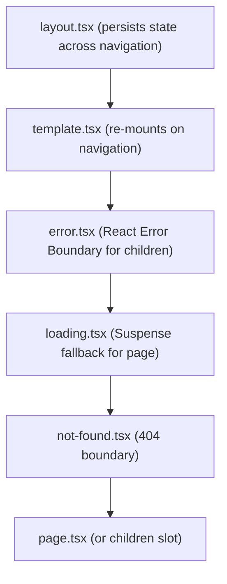

# Routing, Layouts & Route Segments

How `apps/web` organizes routes, handles multi-panel layouts, modals, and segment boundaries.
Written against **Next.js 16.4.0** with React 19, `cacheComponents: true`, and `partialPrefetching: true`.
Sources are the docs shipped with the package (`apps/web/node_modules/next/dist/docs/01-app/`, written `DOCS/` below).
For feature folder layout and component tiers, see [project-structure.md](project-structure.md).
For data fetching and caching rules, see [data-fetching.md](data-fetching.md).

---

## 1. The App Router Segment Hierarchy

Next.js nests route files inside each folder in a deterministic hierarchy (`DOCS/01-getting-started/02-project-structure.md`):



### 1.1 `layout.tsx` vs `template.tsx`

| Feature | `layout.tsx` (Default) | `template.tsx` (Opt-in) |
| :--- | :--- | :--- |
| **Lifecycle** | **Persisted**: Does not re-mount on navigation between child routes. | **Remounted**: Creates a fresh DOM node and component instance on every navigation. |
| **React State** | Retains internal `useState` and DOM state (scroll, input focus). | Resets all `useState`, resets input values. |
| **`useEffect` Execution** | Only runs on initial mount; does not re-run on child route changes. | Re-runs `useEffect` on every navigation. |
| **When to Use** | Application Shell, Navbars, Sidebars, persistent global state. | Page-enter/exit animations, page view analytics tracking, form reset on step change. |

```tsx
// app/(dashboard)/template.tsx
export default function DashboardTemplate({ children }: { children: React.ReactNode }) {
  return (
    <div className="animate-in fade-in duration-200">
      {children}
    </div>
  )
}
```

---

## 2. Route Groups `(folder)`

Route groups organize routes without affecting the URL pathname (`DOCS/03-api-reference/03-file-conventions/route-groups.md`):

1. **Multiple Root Layouts**:
   - `app/(auth)/layout.tsx`: Centered card, minimal shell, no sidebar.
   - `app/(dashboard)/layout.tsx`: Sidebar, top navigation, search command menu.
   - `app/(marketing)/layout.tsx`: Public header, footer, pricing layout.
2. **Co-location without URL Pollution**:
   - Grouping related domains: `app/(dashboard)/cases/` maps to URL `/cases`.

> [!WARNING]
> If you create multiple root layouts (e.g. `app/(auth)/layout.tsx` and `app/(marketing)/layout.tsx` without an outer `app/layout.tsx`), navigating between them forces a **full page reload (hard navigation)** rather than a client-side soft navigation.

---

## 3. Parallel Routes (`@slot`)

Parallel routes allow simultaneously or conditionally rendering multiple independent sub-pages within the same layout (`DOCS/03-api-reference/03-file-conventions/parallel-routes.md`).

### 3.1 Mental Model & Slot Convention
Slots are folders prefixed with `@` (e.g. `@analytics`, `@team`). They are passed as props to the parent layout alongside `children`:

```
apps/web/app/(dashboard)/dashboard/
  layout.tsx
  page.tsx             # Implicit slot: children
  @analytics/
    page.tsx
    loading.tsx        # Independent streaming loading state!
    error.tsx          # Independent error boundary!
  @team/
    page.tsx
    default.tsx        # Fallback for hard navigation
```

```tsx
// app/(dashboard)/dashboard/layout.tsx
export default function DashboardLayout({
  children,
  analytics,
  team,
}: {
  children: React.ReactNode
  analytics: React.ReactNode
  team: React.ReactNode
}) {
  return (
    <div className="space-y-6">
      <section>{children}</section>
      <div className="grid grid-cols-1 md:grid-cols-2 gap-6">
        <div>{analytics}</div>
        <div>{team}</div>
      </div>
    </div>
  )
}
```

### 3.2 Key Architectural Benefits
1. **Independent Streaming & Fallbacks**: If `@analytics` has slow I/O, its own `loading.tsx` renders immediately while `@team` and `children` are already interactive.
2. **Fault Isolation**: If `@analytics` crashes, its local `error.tsx` catches the failure without breaking the rest of the dashboard.
3. **Partial Soft Navigations**: Navigating between sub-tabs inside `@analytics` only re-renders the analytics slot; the rest of the layout and siblings retain 100% of their DOM state.

### 3.3 The `default.tsx` Fallback Rule
- **Soft Navigation (Client-side Link)**: Next.js remembers the active page of unchanged slots.
- **Hard Navigation (Browser Refresh / Direct URL)**: Next.js cannot recover the active subpage for slots that don't match the current URL. It renders `default.tsx` for that slot.
- **Rule**: Always create a `default.tsx` in parallel route slots. If nothing should show, return `null`.

```tsx
// app/(dashboard)/dashboard/@team/default.tsx
export default function TeamDefault() {
  return null
}
```

---

## 4. Intercepting Routes & Shareable Modals

Intercepting routes (`(.)`, `(..)`, `(...)`) allow loading a route from within the current layout while displaying a different URL (`DOCS/03-api-reference/03-file-conventions/intercepting-routes.md`).

### 4.1 Matching Conventions
- `(.)` matches segments on the **same level**.
- `(..)` matches segments **one level above**.
- `(..)(..)` matches segments **two levels above**.
- `(...)` matches segments from the **root `app` directory**.

### 4.2 The Deep-Linked Modal Pattern
Common use case: Clicking a case card in a list opens a modal over the list, updating the URL to `/cases/[id]`. Refreshing or sharing the URL renders the full case detail page.

```
app/(dashboard)/cases/
  page.tsx                     # Case list page
  [id]/
    page.tsx                   # Standalone full-page detail view
  @modal/
    default.tsx                # Returns null when modal is inactive
    (.)[id]/
      page.tsx                 # Intercepted modal component
```

```tsx
// app/(dashboard)/cases/@modal/(.)[id]/page.tsx
import { Modal } from '@/components/shared/modal'
import { CaseDetailView } from '@/features/cases/components/case-detail-view'
import { getCaseDetail } from '@/features/cases/queries'

export default async function CaseModalPage({
  params,
}: {
  params: Promise<{ id: string }>
}) {
  const { id } = await params
  const caseItem = await getCaseDetail(id)

  return (
    <Modal>
      <CaseDetailView caseItem={caseItem} />
    </Modal>
  )
}
```

### 4.3 Closing the Intercepted Modal
To dismiss the modal and restore previous state:
1. **Client Action**: Call `router.back()` from `next/navigation`.
2. **Explicit Link**: Navigate via `<Link href="/cases">`. The `@modal` slot matches `default.tsx` which returns `null`.

---

## 5. Dynamic Segments & Static Generation

### 5.1 Route Parameter Conventions
- Single dynamic segment: `app/cases/[id]/page.tsx` $\rightarrow$ `/cases/123`
- Catch-all segment: `app/docs/[...slug]/page.tsx` $\rightarrow$ `/docs/a/b/c`
- Optional catch-all: `app/docs/[[...slug]]/page.tsx` $\rightarrow$ `/docs` and `/docs/a/b`

### 5.2 Next.js 16 Asynchronous `params` & `searchParams`
In Next.js 16+, `params` and `searchParams` are Promises (`DOCS/01-app/03-api-reference/03-file-conventions/page.md`).

```tsx
// ✅ Correct: Await params in Server Component
export default async function CasePage({
  params,
  searchParams,
}: {
  params: Promise<{ id: string }>
  searchParams: Promise<{ tab?: string }>
}) {
  const { id } = await params
  const { tab = 'overview' } = await searchParams

  return <CaseContent id={id} activeTab={tab} />
}
```

> [!TIP]
> **Push URL access down**: To keep the static shell instant, do not `await searchParams` at the top of a page if only a sub-tab needs it. Pass the promise down and unwrap it inside `<Suspense>` via `use()` or `.then()` (see [data-fetching.md §4.4](data-fetching.md#44-request-time-data)).

### 5.3 `generateStaticParams()`
When routes are known ahead of time, generate them at build time:
```tsx
// app/cases/[id]/page.tsx
export async function generateStaticParams() {
  const topCases = await getFeaturedCaseIds()
  return topCases.map((id) => ({ id }))
}
```

---

## 6. Error Boundaries & Not-Found Conventions

### 6.1 Granular `error.tsx`
`error.tsx` must always be a **Client Component** (`'use client'`). It receives the error object and a `reset()` function:

```tsx
// app/(dashboard)/cases/error.tsx
'use client'
import { Button } from '@workspace/ui/components/button'

export default function CasesError({
  error,
  retry,
}: {
  error: Error & { digest?: string }
  retry: () => void
}) {
  return (
    <div className="p-6 text-center space-y-4">
      <h2 className="text-destructive font-semibold">Failed to load cases</h2>
      <p className="text-muted-foreground text-sm">{error.message}</p>
      <Button variant="outline" onClick={() => reset()}>
        Try again
      </Button>
    </div>
  )
}
```

### 6.2 `global-error.tsx`
`app/error.tsx` catches errors in all child pages, but **does not** catch errors thrown inside the root `app/layout.tsx`.
Root layout crashes require `app/global-error.tsx`, which must define its own `<html>` and `<body>` tags:

```tsx
// app/global-error.tsx
'use client'
export default function GlobalError({
  error,
  reset,
}: {
  error: Error & { digest?: string }
  reset: () => void
}) {
  return (
    <html>
      <body>
        <h2>Application Error</h2>
        <button onClick={() => retry()}>Restart</button>
      </body>
    </html>
  )
}
```

### 6.3 Semantic Status Boundaries
- `notFound()` $\rightarrow$ triggers nearest `not-found.tsx` (HTTP 404).
- `unauthorized()` $\rightarrow$ triggers `unauthorized.tsx` (HTTP 401).
- `forbidden()` $\rightarrow$ triggers `forbidden.tsx` (HTTP 403).

---

## 7. Metadata, SEO & OpenGraph

### 7.1 Dynamic Metadata (`generateMetadata`)
Define static metadata via `metadata` export, or dynamic metadata via `generateMetadata()`:

```tsx
// app/cases/[id]/page.tsx
import type { Metadata } from 'next'
import { getCaseDetail } from '@/features/cases/queries'

export async function generateMetadata({
  params,
}: {
  params: Promise<{ id: string }>
}): Promise<Metadata> {
  const { id } = await params
  const caseItem = await getCaseDetail(id)

  return {
    title: `${caseItem.title} | Case Tracker`,
    description: caseItem.description,
    openGraph: {
      title: caseItem.title,
      description: caseItem.description,
      images: [`/cases/${id}/opengraph-image`],
    },
  }
}
```

> [!NOTE]
> `generateMetadata` runs in parallel with page data fetching. If both call the same cached query (`queries.ts` with `React.cache()` or `"use cache"`), Next.js automatically deduplicates the fetch request.

### 7.2 Programmatic `sitemap.ts` (`/sitemap.xml`)
Generate search engine sitemaps dynamically (`DOCS/03-api-reference/03-file-conventions/04-metadata-file-conventions/sitemap.md`):

```ts
// apps/web/app/sitemap.ts
import type { MetadataRoute } from 'next'
import { getPublicCaseSlugs } from '@/features/cases/server'

export default async function sitemap(): Promise<MetadataRoute.Sitemap> {
  const slugs = await getPublicCaseSlugs()
  const baseUrl = process.env.NEXT_PUBLIC_APP_URL || 'https://example.com'

  const caseUrls = slugs.map((slug) => ({
    url: `${baseUrl}/cases/${slug}`,
    lastModified: new Date(),
    changeFrequency: 'weekly' as const,
    priority: 0.8,
  }))

  return [
    {
      url: baseUrl,
      lastModified: new Date(),
      changeFrequency: 'daily',
      priority: 1,
    },
    ...caseUrls,
  ]
}
```

### 7.3 Programmatic `robots.ts` (`/robots.txt`)
Control search crawler indexing (`DOCS/03-api-reference/03-file-conventions/04-metadata-file-conventions/robots.md`):

```ts
// apps/web/app/robots.ts
import type { MetadataRoute } from 'next'

export default function robots(): MetadataRoute.Robots {
  const baseUrl = process.env.NEXT_PUBLIC_APP_URL || 'https://example.com'

  return {
    rules: [
      {
        userAgent: '*',
        allow: '/',
        disallow: ['/dashboard/', '/api/', '/auth/'],
      },
    ],
    sitemap: `${baseUrl}/sitemap.xml`,
  }
}
```

### 7.4 Dynamic Social Share Images (`next/og`)
Generate dynamic Open Graph cards on the edge using JSX and `@vercel/og` (`DOCS/03-api-reference/03-file-conventions/04-metadata-file-conventions/opengraph-image.md`):

```tsx
// apps/web/app/cases/[id]/opengraph-image.tsx
import { ImageResponse } from 'next/og'
import { getCaseDetail } from '@/features/cases/queries'

export const runtime = 'edge'
export const size = { width: 1200, height: 630 }
export const contentType = 'image/png'

export default async function Image({
  params,
}: {
  params: Promise<{ id: string }>
}) {
  const { id } = await params
  const caseItem = await getCaseDetail(id)

  return new ImageResponse(
    (
      <div
        style={{
          background: 'linear-gradient(to bottom right, #09090b, #18181b)',
          color: 'white',
          width: '100%',
          height: '100%',
          display: 'flex',
          flexDirection: 'column',
          justifyContent: 'center',
          padding: '60px',
        }}
      >
        <div style={{ fontSize: 32, color: '#a1a1aa' }}>Case Record</div>
        <div style={{ fontSize: 64, fontWeight: 'bold', marginTop: 16 }}>
          {caseItem.title}
        </div>
      </div>
    ),
    { ...size }
  )
}
```
